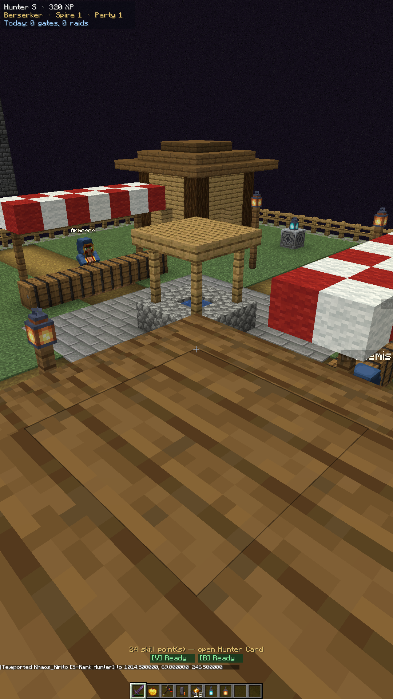

# Khaos Nexus

**Break the gates. Climb the Spire. Become a National-level hunter.**

Khaos Nexus is an anime-inspired RPG mod for Minecraft 1.21.1 (NeoForge). Ranked dungeon gates tear open across your world, an endless tower waits in its own dimension, and every player picks a hunter class and climbs from E rank to S rank and beyond. It is a complete adventure on its own, and it scales up when you add other mods.

> **Status:** 1.0.0 for Minecraft 1.21.1 (NeoForge). Works on its own and alongside large modpacks.

## Features
- **Nexus Gates, ranked E to S:** gates tear open near players a few times a day. Clear the mob wave, or step through into a themed dungeon instance with a boss, for loot by rank. Then the gate collapses.
- **Hunter Tomes (with Ars Nouveau):** casting classes get an Ars spell book that evolves with hunter rank (E to Monarch), gaining slots, glyph tier, source discount and a class attunement while keeping its spells.
- **Dungeon themes:** Rift Bastion, Frostbound Crypt, Overgrown Ruin, Scorched Forge, Sunken Temple, Void Sanctum and Sculk Hollow (plus Create and Mowzie themes when those mods are installed). Themes are picked by biome and fully data-driven.
- **Red Gates and dungeon breaks:** a rare Red Gate locks you in until you clear it, and its boss is stronger, but it pays double XP, bonus Rift Cores and a title. A gate nobody clears breaks open and spills its mobs into the world, and the server is warned.
- **Weekly modifiers:** every week, A and S gates roll rotating modifiers (Glass Cannon, Ironhide, Frenzy and more) that pay bonus XP and cores.
- **8 hunter classes:** Tank, Assassin, Caster, Ranger, Lifebinder, Berserker, Summoner and Necromancer, each with two keybound abilities and a skill tree. Upgrade power, cooldown and radius, take passives, and unlock a capstone at rank A.
- **Hunter ranks E to S, then SS and National:** rank up with hunter XP. Past S, prestige ranks are earned by achievements: clear a Red Gate and climb the Spire. They grant a title, an aura and bonus skill points, and SS hunters can open SS gates.
- **Class mastery:** XP earned at rank S fills a per-class mastery track (levels 1–50). Spend the points on sidegrade perks, where each perk pairs a gain with a cost. Respec any time.
- **The Nexus Spire:** a tower in its own dimension. Each floor is 10 themed boss arenas, and the style changes floor by floor. Beat a level's guardian and its rift-gate lights up to take you onward. Every floor opens with a safe town that has an Alchemist, an Armorer (stock scales with your floor and rank), a repair Smith and a checkpoint. Deep floors scale up endlessly, and each floor's final guardian rolls an affix.
- **Leaderboards:** `/khaosnexus top` shows fastest clears per rank, Spire progress per season and weekly-modifier clears.
- **Cosmetic auras:** particle auras unlocked by achievements, shown in the world and on the Hunter Card.
- **Raids** for parties of up to 5, with personal loot and a lockout.
- **Hunter Card** with profile, nearby gates, skills and forge tabs, plus a cooldown HUD. Get it from the Guild Clerk or a Guild Desk.
- **Hunter Forge:** upgrade gear and class weapons with tiered materials, Rift Essence and Rift Cores.
- **Bosses:** the Khaos Warden of the Rift and the Spire Guardian, each with special attacks and an enrage phase.

## Works with your modpack (all optional)
- Apotheosis, Apothic Attributes, Iron's Spells and Ars Nouveau class bonuses, plus FTB stages and Curios.
- Optional items when their mods are installed: an Ars Nouveau glyph and shard, a Relics necklace, and Artifacts curios.
- L_Ender's Cataclysm bosses can appear in S-rank gates, with tuned health and damage, no arena griefing and a void rescue.
- `/khaosnexus compat check` reports what was detected.

## Commands
`/khaosnexus spire [enter|leave|checkpoint]` · `top <E..S|spire|weekly>` · `weekly` · `prestige` · `mastery [pick|reset]` · `aura [equip|clear]` · `title` · `party` · `bounty` · `class`

## Configuration
Everything is in `khaosnexus-server.toml`. The post-S content is in the `[endgame]` section and the tower in `[spire]`. Content is datapack-driven: gate modifiers, Spire themes, vendors and affixes, auras, mastery perks, dungeon themes, skill trees and forge tiers each live in a `data/<namespace>/khaosnexus_*` folder that you can override.

**Coming in 1.1** (included, but switched off by default): boss rush, monthly challenge gates, Second Awakening and 8-player group raids. Server owners can try them early with the matching `[endgame]` toggles.

## How to play
1. Get a Hunter Card from the Guild Clerk (or a Guild Desk), then pick a class (O).
2. Find a Nexus Gate. Right-click it to start the wave, or step inside to enter its dungeon.
3. Earn hunter XP to rank up and gain skill points. Spend them on the Hunter Card's Skills tab (J).
4. At any time, use `/khaosnexus spire enter` (or a Spire Gate block) to start climbing the tower.

## Building
`./gradlew build` builds the jar into `build/libs/`. `./gradlew runGameTestServer` runs the headless game tests.

## License
See [LICENSE](LICENSE).
